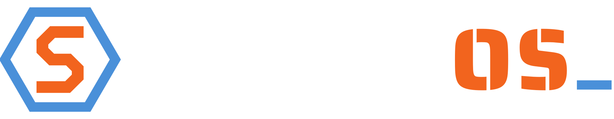

  

<strong>Built solid. Plays everything.</strong>

Steel OS is a Linux desktop for everyday people that works the way Windows
does. It updates itself every Tuesday and keeps the previous version one
restart away. It installs apps with one click, prints without hunting for
drivers, and plays Steam games out of the box.

Steel OS is a [Steel & Code](https://steelandcode.com) project in partnership
with [Blackbox Entertainment](https://blackbox-entertainment.com).
Website and downloads: **[steel-os.org](https://steel-os.org)**.

> **Status: 0.2.0 Preview for testers.** The system image builds, signs and
> updates. The first installer ISO is in testing. The stable 1.0 release comes
> when the guided installer, the Steel Apps screen and the core features below
> are finished. See [docs/roadmap.md](docs/roadmap.md).

## What you get

| | |
|---|---|
| **Safe updates** | The whole system updates as one tested image, automatically every Tuesday at 4 am. If an update ever goes wrong, pick the previous version in the boot menu. |
| **Easy like Windows** | KDE Plasma desktop, windows that cascade, a start menu in plain English ("Web Browser (Firefox)"), printers and network PCs found without a terminal. |
| **Plays games** | Steam, Proton, Lutris and controller support built in. |
| **Apps that just install** | LibreOffice, Firefox, OBS Studio, Kdenlive, Obsidian, Moonlight and Zed come pre-installed. Chrome, Slack, Zoom, Discord and more are one click away. |
| **Keyboard-first if you want it** | Super+Enter opens the terminal (Konsole), Super+Shift+Enter opens Firefox, Alt+C and Alt+V copy and paste. Full list in [docs/keyboard-shortcuts.md](docs/keyboard-shortcuts.md). |
| **Built-in security** | Read-only system files, sandboxed apps, a firewall, Secure Boot support, and updates signed by us. |

## How it is built

Steel OS is not a fork and has no installer of its own to maintain. It is a
short recipe on top of [Bazzite](https://bazzite.gg), the Fedora Atomic gaming
desktop by [Universal Blue](https://universal-blue.org):

1. `Containerfile` starts from `ghcr.io/ublue-os/bazzite:stable`.
2. `build_files/build.sh` adds our settings, packages, branding and signing key.
3. GitHub Actions builds the image every day and publishes it, signed, to
   `ghcr.io/rodger-roberts-dev/steel-os:latest`. Installed machines update from there.
4. The installer ISO is built from the same image on demand, the same way
   Bazzite builds its own (live desktop plus Fedora's web installer), in Steel OS colours.

Nothing is built on anyone's PC. Details for contributors are in
[docs/building.md](docs/building.md) and [ARCHITECTURE.md](ARCHITECTURE.md).

## Repository layout

| Path | What it is |
|---|---|
| `Containerfile`, `build_files/build.sh` | The image recipe |
| `system_files/` | Settings copied into the image at the same paths (Plasma, Konsole, updates, branding) |
| `packages/` | Plain-text lists: extra system packages, default apps, one-click apps, things hidden or removed |
| `installer/` | The live desktop and installer used to make the ISO |
| `branding/` | Logos, icon, wallpapers and the brand guide |
| `docs/` | Plans, research and how-tos |
| `.github/workflows/` | Daily image build; ISO build |
| `cosign.pub` | Public key that verifies our images. The private key is never in this repo. |

## Try it

The 0.2.0 Preview is for testers, in a virtual machine or on a spare PC.
Download it from [steel-os.org](https://steel-os.org) when the preview link is
live, or build the ISO yourself from the Actions tab ("Build disk images").

Found a problem? [Open an issue](https://github.com/rodger-roberts-dev/steel-os/issues)
with what you did, what you expected and what happened.

## Contributing

Work is planned in Jira (project STEEL). Every change goes through a pull
request and is reviewed by the project lead before it is merged. Rules for
contributors and for the AI assistant used on this project are in
[CLAUDE.md](CLAUDE.md).

## Credits and licence

Built on [Bazzite](https://github.com/ublue-os/bazzite) and the
[Universal Blue image template](https://github.com/ublue-os/image-template),
both Apache-2.0, on top of [Fedora](https://fedoraproject.org).

The Steel OS build recipe is licensed under the [Apache License 2.0](LICENSE).
The Steel OS name, logo and artwork belong to Steel & Code and are not covered
by that licence; see [NOTICE](NOTICE) and [branding/README.md](branding/README.md).
